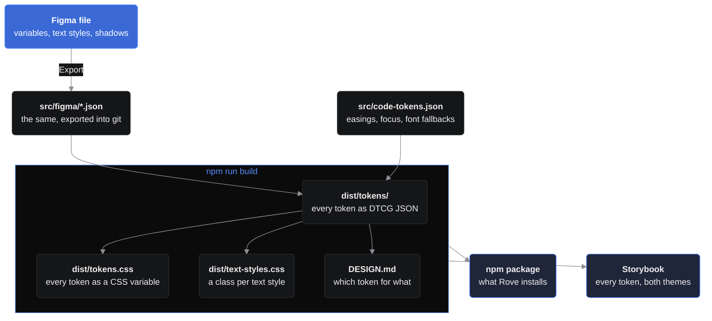

<div align="center">


# Rove Tokens

Tokens for Rove, straight from the Rove Design System in Figma.

`@swiftsolve/rove-tokens`

[](https://github.com/swiftsolve/rove-tokens/actions/workflows/build.yml)
[](https://github.com/swiftsolve/rove-tokens/actions/workflows/presentation.yml)
[](https://github.com/swiftsolve/rove-tokens/tags)
[](https://www.figma.com/design/NoICIoyhWNOya9tOnNfEhH/Rove-Design-System)

[](https://www.designtokens.org/tr/2025.10/format/)
[](https://styledictionary.com/)
[](#-contrast)
[](#-use)
[](.nvmrc)

[🎨 Figma file](https://www.figma.com/design/NoICIoyhWNOya9tOnNfEhH/Rove-Design-System) &nbsp;·&nbsp;
[🖼️ Slideshow](https://swiftsolve.github.io/rove-tokens/) &nbsp;·&nbsp;
[📐 DESIGN.md](DESIGN.md) &nbsp;·&nbsp;
[💡 Rationale](docs/rationale.md)

[📖 Tokens Storybook](https://rove.swiftsolve.net/storybook/tokens/) &nbsp;·&nbsp;
[🧱 Components Storybook](https://rove.swiftsolve.net/storybook/)

</div>

---

Tokens are designed in Figma and released from git. A [Figma plugin](figma-plugin/) exports the file's variables, text styles and shadows, and this package turns them into DTCG token files, and those into CSS with [Style Dictionary](https://styledictionary.com/). Tokens only flow that way: nothing here writes to Figma, and the plugin's check lists anything in the repo that no longer matches the file. A token ships only through a commit, the build and a release.

> [!TIP]
> **Building Rove UI?** [`DESIGN.md`](DESIGN.md) says which token to use for what, with every value. It ships in the package, so coding agents in Rove can read it from `node_modules/@swiftsolve/rove-tokens/DESIGN.md`.

## ⚙️ How it works



Each box says what it holds. Two steps make them: the plugin's Export, and `npm run build`, whose scripts (and [Style Dictionary](https://styledictionary.com/), which writes `tokens.css`) are listed in [What's where](#️-whats-where). Nothing flows back into Figma: to change a token, change it there and export it. `npm run figma:check` confirms the repo still matches the file. The slideshow (`npm run present`) is separate: it exports the Figma file's pages, styled with `tokens.css`.

## 📦 Use

```bash
npm install @swiftsolve/rove-tokens
```

The package ships them built, in `dist/`; the import paths below point there. You can also install straight from a version tag (`github:swiftsolve/rove-tokens#v1.1.0`); then npm builds them on install, which needs Node 22 (see `.nvmrc`).

```css
@import '@swiftsolve/rove-tokens/tokens.css';
@import '@swiftsolve/rove-tokens/text-styles.css'; /* optional: a class per text style */
```

Dark values sit on `:root`, Light values on `:root.theme-light`. CSS names follow the Figma names: `bg/base` is `--bg-base`, `spacing/12` is `--spacing-12`.

Every colour lives once in the Palette collection (`neutral/850`, `blue/450`; higher numbers are darker; a see-through shade adds `-a` and its opacity, `neutral/850-a10`), and the Color tokens point at it. The Palette isn't in `tokens.css`: a token that points at a shade gets the shade's value there. Figma-only collections (Icon tone, Capability level) and variables without a code syntax aren't in `tokens.css` either.

Each Figma text style becomes four tokens: `--type-<style>-size`, `-weight`, `-line-height` (a unitless ratio) and `-letter-spacing` (in `em`). `Number/Display` gives `--type-number-display-size` and so on. A size bound to a variable comes through as that variable (`var(--font-size-3xl)`).

`text-styles.css` applies a style whole: `.type-heading-large` sets the font family and all four, plus the text case (Overline is uppercase). The classes set no colour and sit in `@layer components`, so Tailwind utilities on the same element still win.

### 🧩 DTCG

`dist/tokens/` (imported as `@swiftsolve/rove-tokens/tokens/*`) holds the same tokens in the [Design Tokens Format](https://www.designtokens.org/tr/2025.10/format/) (2025.10), for Style Dictionary, Tokens Studio and similar tools:

| File | What |
| --- | --- |
| `palette.tokens.json` | Every colour, once |
| `color.dark.tokens.json`, `color.light.tokens.json` | The Color tokens in each theme, pointing at the palette (`{neutral.850}`) |
| `spacing.tokens.json`, `typography.tokens.json`, `opacity.tokens.json`, `layout.tokens.json`, `motion.tokens.json` | The other Figma collections |
| `text-styles.tokens.json` | Each text style as a `typography` token |
| `code.tokens.json` | The code-only tokens (shadows, easing curves, the focus outline) |

A theme is every file plus one of the two color files. Paths follow the Figma names (`bg/base` is `bg.base`). Tokens that other tokens point at but that aren't CSS variables (the palette, the shadow colours) are marked `"$extensions": { "net.swiftsolve.rove-tokens": { "css": false } }`. CSS-only expressions (`--focus-inset`, a `calc()`) aren't in them.

## ♿ Contrast

The colours meet [WCAG 2.2](https://www.w3.org/TR/WCAG22/) level AA in both themes, on the surfaces they sit on: text clears 4.5:1 ([1.4.3 Contrast (Minimum)](https://www.w3.org/WAI/WCAG22/Understanding/contrast-minimum.html)), and icons, bars and dots 3:1 ([1.4.11 Non-text Contrast](https://www.w3.org/WAI/WCAG22/Understanding/non-text-contrast.html)). AAA (7:1) isn't a target. [Rationale](docs/rationale.md) has the close calls. `scripts/checks/contrast.mjs` measures every pair, so a release can't break this.

## 📖 Storybook

Two Storybooks are hosted on rove.swiftsolve.net:

- [**Rove Tokens**](https://rove.swiftsolve.net/storybook/tokens/): every token in both themes (colour, palette, type, spacing, radius, effects, motion and layout), built from this repo's `main`.
- [**Rove Components**](https://rove.swiftsolve.net/storybook/): the Rove app's UI library, built from the tokens.

To run Rove Tokens locally:

```bash
npm run storybook
```

It opens on <http://localhost:6007>; the Theme menu in the toolbar switches Dark and Light. The pages read the DTCG files in `dist/tokens/` and are styled with `dist/tokens.css`, so a new build shows up without editing them.

## 🛠️ Scripts

| Script | What it does |
| --- | --- |
| `npm run build` | Figma export → DTCG → `tokens.css`, `text-styles.css` and the `DESIGN.md` reference. `npm install` and `npm publish` run it too. |
| `npm run storybook` | The Rove Tokens Storybook on port 6007 |
| `npm run build:storybook` | A static copy of it in `storybook-static/` |
| `npm run figma:check` | A script for the Figma MCP's `use_figma` that lists every difference between the Figma file and the repo. `figma:export` reads the file, and `figma:save <result.json>` writes an export into `src/figma/`. |
| `npm run present` | Builds, then exports the Figma file's pages to the slideshow in `presentation/`. Needs `FIGMA_TOKEN` in `.env.local`. |
| `npm run present:publish` | Pushes that slideshow to GitHub Pages |

## 🔄 Update the tokens

A change can start in Figma or here. It ships only once it's committed, and Figma and the repo agree.

**In Figma**

1. Change the variables, text styles or `Shadow/*` effect styles in Figma.
2. Export them to `src/figma/variables.json`, `src/figma/text-styles.json` and `src/figma/effect-styles.json`, either with the plugin in `figma-plugin/` (Figma desktop: Plugins → Development → Import plugin from manifest; then **Export**) or through the Figma MCP (`npm run figma:export`, then `npm run figma:save <result.json>`).
3. Run `npm run build` (Node 22) and check `dist/tokens.css`. The build stops if a variable's code syntax doesn't match its name, or a DTCG reference doesn't resolve.
4. Commit the change.

**Only what Figma can't hold** (font stacks, easing curves, the focus expressions) is edited here, in `src/code-tokens.json`; then build and commit. Never edit `src/figma/*.json` by hand: it's an export, and the next one would undo it.

**Then check.** The plugin's **Check** tab (against the files you choose from a checkout) or `npm run figma:check` lists every difference: values, code syntax, descriptions, scopes, text styles and shadows. A difference means the repo is behind Figma (export again) or was edited by hand (undo it, and make the change in Figma).

## 🚀 Release

1. On the Figma cover (`COVER` page), set **Version** to the one you're about to release and **Updated** to today's date (`27 Oct 2026`). They're the one place a release can't be stamped from here: Figma's API can't edit canvas text on this plan, so do it by hand or ask Claude to through the Figma connection.
2. Bump, commit and tag in one step, then push both:

   ```bash
   npm version minor
   ```

   ```bash
   git push --follow-tags
   ```

   Use `patch` for fixes and `major` for breaking changes.
3. The tag runs three workflows: **Build** checks the tokens, **Publish** puts the version on [npm](https://www.npmjs.com/package/@swiftsolve/rove-tokens) through npm trusted publishing (`npx npm@11 trust list @swiftsolve/rove-tokens` shows the link to `publish.yml`; if Publish fails, `npm publish` by hand works too), and **Presentation** exports the Figma file and republishes <https://swiftsolve.github.io/rove-tokens/>. The page's header shows the version from `package.json`. To republish the slideshow between releases (after Figma edits), run Presentation by hand from the Actions tab.
4. Update Rove to the new version (`npm install @swiftsolve/rove-tokens@latest`).

## 🗂️ What's where

**Sources and the export**

| Path | What |
| --- | --- |
| `src/figma/variables.json` | Raw Figma export. Every variable with a Web code syntax becomes that CSS variable. |
| `src/figma/text-styles.json` | Raw export of the local text styles: font, size, weight, line height, letter spacing, text case (when set) and the variables bound to them. Each style becomes a `--type-*` group. |
| `src/figma/effect-styles.json` | Raw export of the `Shadow/*` effect styles: each layer's offset, blur, spread and the colour variable bound to it. Each style becomes a `--shadow-*` token. |
| `figma-plugin/` | Rove Tokens, the Figma plugin. **Export** writes the three exports: every local variable by collection and mode (aliases and scopes kept, in the variables panel's order), every local text style with the variables bound to it, and the `Shadow/*` effect styles. **Check** compares the file with the three files you choose from a checkout and lists every difference. It never writes to the file, and needs no network access. |
| `scripts/figma/use-figma.mjs` | `npm run figma:export` and `figma:check`: the plugin's own code, wrapped for the Figma MCP's `use_figma`, so an agent exports and checks the same way. |
| `src/code-tokens.json` | What Figma can't hold: font stacks for the font-family variables, easing curves and the CSS expressions built on variables (`--focus-outline`). `{figma/name}` pulls a Figma value in per theme. |

**Build**

| Path | What |
| --- | --- |
| `scripts/tokens/build.mjs` | `npm run build`: runs the steps below, writing everything to `dist/`, where `package.json`'s `exports` points the import paths. |
| `scripts/tokens/figma-to-dtcg.mjs` | Figma export → the DTCG files in `dist/tokens/`, checking that every reference resolves in both themes. |
| `scripts/tokens/dtcg-to-css.mjs` | DTCG files → `tokens.css`, with Style Dictionary and a `rove/css` format: Dark on `:root`, what differs in Light on `:root.theme-light`, each text style as four `--type-*` variables (letter spacing included). |
| `scripts/tokens/dtcg-to-text-styles.mjs` | DTCG text styles → `text-styles.css`: a `.type-<style>` class per style that reads its `--type-*` variables. |
| `scripts/tokens/token-reference.mjs` | Figma export and `tokens.css` → the token reference in `DESIGN.md`: every token by name and Figma description, with values for the scales (spacing, radius, type, opacity) but not the colours, so nobody copies a hex. |
| `scripts/tokens/shared.mjs` | Helpers the steps share, so they all write a colour and name a text style the same way. |
| `DESIGN.md` | How to build Rove UI with the tokens. The rules at the top are written by hand; the token reference below the marker line is generated by the build. |

**Storybook and slideshow**

| Path | What |
| --- | --- |
| `.storybook/` | The Rove Tokens Storybook's config, and the Inter, Questrial and Geist Mono files it bundles. |
| `stories/` | Its pages, one file per sidebar group, each with its own CSS (`stories.css` is what they share; images in `assets/`). `tokens.js` reads the DTCG files. |
| `scripts/presentation/export.mjs` | `npm run present`: exports the Figma file's pages to `presentation/index.html`, a slideshow styled with the tokens. Needs `FIGMA_TOKEN` (a Figma personal access token, `file_content:read`) in `.env.local`. |
| `scripts/presentation/publish.mjs` | `npm run present:publish`: pushes the exported presentation to the `gh-pages` branch, which GitHub Pages serves at <https://swiftsolve.github.io/rove-tokens/>. Each publish replaces the last. |

**Workflows and docs**

A release tag is the `v1.2.0`-style git tag that `npm version` creates and `git push --follow-tags` pushes (see [Release](#-release)).

| Path | What |
| --- | --- |
| `.github/workflows/build.yml` | On each release tag, builds the tokens, lints, and runs every check in `scripts/checks/`. Run it by hand from Actions to check `main`. |
| `scripts/checks/run.mjs` | Runs every check in its folder and reports them all before failing; `npm run check` and the build workflow call it. A new check there runs without being listed. |
| `scripts/checks/contrast.mjs` | Measures every text and graphic colour on what DESIGN.md lets it sit on, in both themes, against [Contrast](#-contrast)'s targets. |
| `scripts/checks/figma-plugin.mjs` | Runs the plugin against a stand-in Figma file made from the repo. Export must give back `src/figma/*.json`, and Check must find nothing, then each planted difference. |
| `.github/workflows/publish.yml` | On each release tag, publishes that version to npm with trusted publishing, so the repo holds no npm token. |
| `.github/workflows/presentation.yml` | On each release tag, or by hand from Actions, exports the slideshow from Figma and publishes it. Needs the `FIGMA_TOKEN` repository secret. |
| `docs/rationale.md` | Why the values are what they are (contrast targets, theme choices). |
