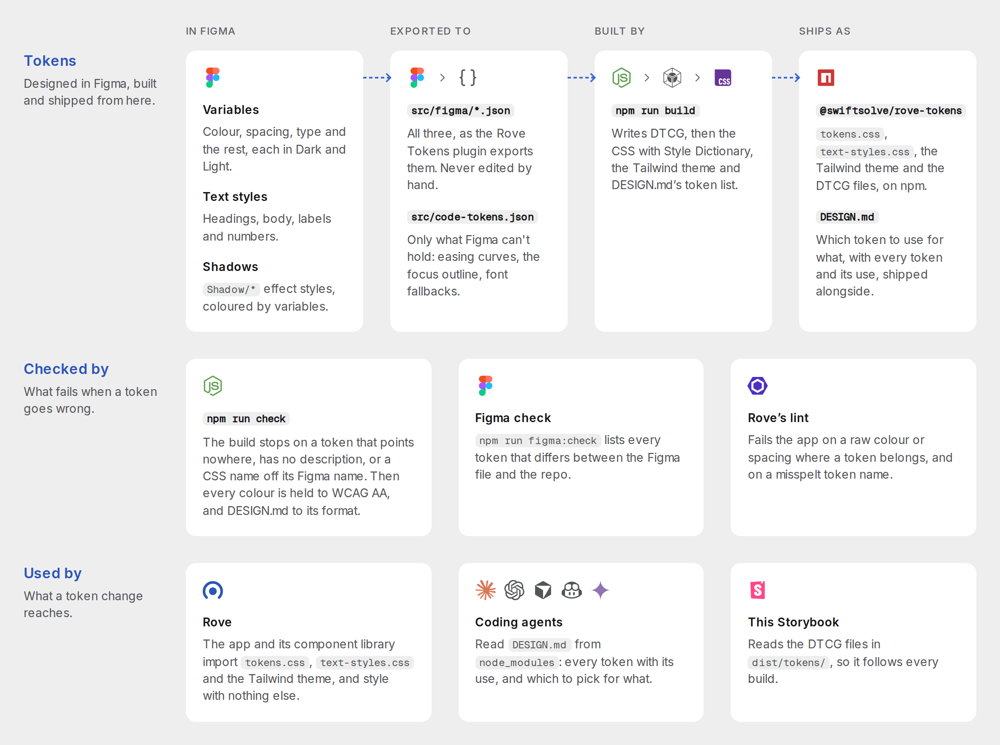

<div align="center">


# Rove Tokens

Tokens for Rove, straight from the Rove Design System in Figma.

[`@swiftsolve/rove-tokens`](https://www.npmjs.com/package/@swiftsolve/rove-tokens)

[](https://github.com/swiftsolve/rove-tokens/actions/workflows/publish.yml)
[](https://www.npmjs.com/package/@swiftsolve/rove-tokens)
[](https://www.figma.com/design/NoICIoyhWNOya9tOnNfEhH/Rove-Design-System)

[](https://www.designtokens.org/tr/2025.10/format/)
[](https://styledictionary.com/)
[](#contrast)
[](#use)

[🎨 Figma file](https://www.figma.com/design/NoICIoyhWNOya9tOnNfEhH/Rove-Design-System) &nbsp;·&nbsp;
[📐 DESIGN.md](DESIGN.md) &nbsp;·&nbsp;
[💡 Rationale](docs/rationale.md)

[📖 Tokens Storybook](https://rove.swiftsolve.net/storybook/tokens/) &nbsp;·&nbsp;
[🧱 Components Storybook](https://rove.swiftsolve.net/storybook/)

</div>

---

Tokens are designed in the Rove Design System in Figma and released from git, one way. A [Figma plugin](figma-plugin/) exports the file's variables, text styles and shadows into this repo; `npm run build` turns them into DTCG token files, and those into CSS with [Style Dictionary](https://styledictionary.com/); a release puts them on npm. Nothing here writes to Figma, and the plugin's check lists anything in the repo that no longer matches the file.

> [!TIP]
> **Building Rove UI?** [`DESIGN.md`](DESIGN.md) says which token to use for what, in the [DESIGN.md format](https://github.com/google-labs-code/design.md), and its front matter lists every token with its value and use. It ships in the package, so coding agents in Rove can read it from `node_modules/@swiftsolve/rove-tokens/DESIGN.md`.

## Use

### Install

```bash
npm install @swiftsolve/rove-tokens
```

The package ships the tokens built, in `dist/`; the import paths below point there. You can also install straight from a version tag (`github:swiftsolve/rove-tokens#v3.2.0`); then npm builds them on install, which needs Node 22 (see `.nvmrc`).

### CSS variables

```css
@import '@swiftsolve/rove-tokens/tokens.css';
@import '@swiftsolve/rove-tokens/text-styles.css'; /* optional: a class per text style */
```

Dark values sit on `:root`, Light values on `:root.theme-light`. CSS names follow the Figma names: `bg/base` is `--bg-base`, `spacing/12` is `--spacing-12`.

Every colour lives once in the Palette collection (`neutral/850`, `blue/450`; higher numbers are darker; a see-through shade adds `-a` and its opacity, `neutral/850-a10`), and the Color tokens point at it. The Palette isn't in `tokens.css`: a token that points at a shade gets the shade's value there. Figma-only collections (Icon tone, Capability level) and variables without a code syntax aren't in `tokens.css` either.

### Text styles

Each Figma text style becomes four tokens: `--type-<style>-size`, `-weight`, `-line-height` (a unitless ratio) and `-letter-spacing` (in `em`). `Number/Display` gives `--type-number-display-size` and so on. A size bound to a variable comes through as that variable (`var(--font-size-3xl)`).

`text-styles.css` applies a style whole: `.type-heading-large` sets the font family and all four, plus the text case (Label/Field is uppercase). The classes set no colour and sit in `@layer components`, so Tailwind utilities on the same element still win.

### Tailwind

`tailwind-theme.css` is a [Tailwind v4](https://tailwindcss.com/docs/theme) theme made of the tokens and nothing else: it clears Tailwind's own scales, so `p-12` is `--spacing-12`, `text-md` is `--font-size-md`, `bg-surface` is `--bg-surface`, and there's no `p-7` or `text-blue-500` to reach for. Import it with the tokens in the CSS file that sets Tailwind up:

```css
@import '@swiftsolve/rove-tokens/tokens.css';
@import '@swiftsolve/rove-tokens/tailwind-theme.css';
```

Each utility uses the token itself (`padding: var(--spacing-12)`), so the theme switch flows through. Colours drop the group the utility already says: `bg/surface` is `bg-surface`, `text/primary` is `text-primary`, `border/default` is `border-line`, `text/accent` is `text-accent-text`; status, series, overlay and focus keep theirs (`bg-status-positive`). Each text style also gives `leading-<style>` and `tracking-<style>`.

### DTCG files

`dist/tokens/` (imported as `@swiftsolve/rove-tokens/tokens/*`) holds the same tokens in the [Design Tokens Format](https://www.designtokens.org/tr/2025.10/format/) (2025.10), for Style Dictionary, Tokens Studio and similar tools:

| File | What |
| --- | --- |
| `palette.tokens.json` | Every colour, once |
| `color.dark.tokens.json`, `color.light.tokens.json` | The Color tokens in each theme, pointing at the palette (`{neutral.850}`) |
| `spacing.tokens.json`, `typography.tokens.json`, `opacity.tokens.json`, `layout.tokens.json`, `motion.tokens.json` | The other Figma collections |
| `text-styles.tokens.json` | Each text style as a `typography` token |
| `code.tokens.json` | The code-only tokens (shadows, easing curves, the focus outline) |

A theme is every file plus one of the two color files. Paths follow the Figma names (`bg/base` is `bg.base`). Tokens that other tokens point at but that aren't CSS variables (the palette, the shadow colours) are marked `"$extensions": { "net.swiftsolve.rove-tokens": { "css": false } }`. CSS-only expressions (`--focus-inset`, a `calc()`) aren't in them.

## Contrast

The colours meet [WCAG 2.2](https://www.w3.org/TR/WCAG22/) level AA in both themes, on the surfaces they sit on: text clears 4.5:1 ([1.4.3 Contrast (Minimum)](https://www.w3.org/WAI/WCAG22/Understanding/contrast-minimum.html)), and icons, bars and dots 3:1 ([1.4.11 Non-text Contrast](https://www.w3.org/WAI/WCAG22/Understanding/non-text-contrast.html)). AAA (7:1) isn't a target. [Rationale](docs/rationale.md) has the close calls. `scripts/checks/contrast.mjs` measures every pair, so a release can't break this.

## Storybook

Two Storybooks are hosted on rove.swiftsolve.net:

- [**Rove Tokens**](https://rove.swiftsolve.net/storybook/tokens/): every token in both themes (colour, palette, type, spacing, radius, effects, motion and layout), built from this repo's `main`.
- [**Rove Components**](https://rove.swiftsolve.net/storybook/): the Rove app's UI library, built from the tokens.

To run Rove Tokens locally, `npm run storybook`. It opens on <http://localhost:6007>; the Theme menu in the toolbar switches Dark and Light. The pages read the DTCG files in `dist/tokens/` and are styled with `dist/tokens.css`, so a new build shows up without editing them.

## How it works

<picture>
  <source media="(prefers-color-scheme: dark)" srcset="docs/assets/how-it-works-dark.png">
  
</picture>

The diagram is the [Storybook's Introduction](https://rove.swiftsolve.net/storybook/tokens/). [What's where](#whats-where) lists the scripts behind each step.

## Update the tokens

Every change starts in Figma. It ships once it's exported, built, committed and released, and `figma:check` finds no difference between Figma and the repo. Coding agents follow the same steps in the [`update-tokens` skill](.claude/skills/update-tokens/SKILL.md).

1. Change the variables, text styles or `Shadow/*` effect styles in Figma. A new token takes its siblings' collection, modes, scopes and code syntax, and a description.
2. Export them to `src/figma/variables.json`, `src/figma/text-styles.json` and `src/figma/effect-styles.json`, either with the plugin in `figma-plugin/` (Figma desktop: Plugins → Development → Import plugin from manifest; then **Export**) or through the Figma MCP (`npm run figma:export`, then `npm run figma:save <result.json>`).
3. Run `npm run check` (Node 22). It builds, so check `dist/tokens.css` too. The build stops if a token has no description, a variable's code syntax doesn't match its name, or a DTCG reference doesn't resolve. It rewrites `DESIGN.md`'s front matter: commit it with the change.
4. Check that the repo matches Figma: the plugin's **Check** tab (against the files you choose from a checkout) or `npm run figma:check` lists every difference in values, code syntax, descriptions, scopes, text styles and shadows. A difference means the repo is behind Figma (export again) or was edited directly (undo it, and make the change in Figma).
5. Commit the change.

**Only what Figma can't hold** (font stacks, easing curves, the focus expressions) is edited here, in `src/code-tokens.json`; then check and commit. `src/figma/*.json` changes only by export, since the next export undoes a direct edit.

## Release

Changes collect on `main` and go out together, when Rove needs them.

1. On the Figma cover (`COVER` page), set **Version** to the one you're about to release and **Updated** to today's date (`27 Oct 2026`). They're the one place a release can't be stamped from here: Figma's API can't edit canvas text on this plan, so edit them in Figma, or have an agent do it through the Figma connection.
2. Bump, commit and tag in one step, then push both:

   ```bash
   npm version minor
   git push --follow-tags
   ```

   Pick the bump by what Rove sees: `patch` when no CSS variable is added, removed or renamed; `minor` for a new token; `major` for a rename or removal.
3. The tag runs the **Release** workflow: it runs `npm run check`, and only if that passes puts the version on [npm](https://www.npmjs.com/package/@swiftsolve/rove-tokens) through npm trusted publishing (`npx npm@11 trust list @swiftsolve/rove-tokens` shows the link to `publish.yml`; if it fails to publish, `npm publish` from a checkout works too).
4. In Rove, once npm serves it: `npm install @swiftsolve/rove-tokens@<version>`, run its `npm run check`, and commit. Then resync the sites that embed Rove, with Rove's `resync-sites` skill.

## Scripts

| Script | What it does |
| --- | --- |
| `npm run build` | Figma export → DTCG → `tokens.css`, `text-styles.css`, `tailwind-theme.css` and `DESIGN.md`'s front matter. `npm install` and `npm publish` run it too. |
| `npm run check` | Builds, lints, then runs the contrast and DESIGN.md format checks and `npm test`. Run it before every commit; CI runs it on every release tag, before publishing. |
| `npm test` | The Figma plugin's test: Export and Check against a stand-in file made from the repo. |
| `npm run lint` | ESLint and Prettier over the repo. `npm run format` fixes what Prettier reports. |
| `npm run figma:export` | Prints a script for the Figma MCP's `use_figma` that exports the file; `figma:save <result.json>` writes its result into `src/figma/`. |
| `npm run figma:check` | Prints a script for `use_figma` that lists every difference between the Figma file and the repo. |
| `npm run storybook` | The Rove Tokens Storybook on port 6007; `build:storybook` writes a static copy to `storybook-static/`. |

## What's where

**Sources**

| Path | What |
| --- | --- |
| `src/figma/variables.json` | Raw Figma export. Every variable with a Web code syntax becomes that CSS variable. |
| `src/figma/text-styles.json` | Raw export of the local text styles: font, size, weight, line height, letter spacing, text case (when set) and the variables bound to them. Each style becomes a `--type-*` group. |
| `src/figma/effect-styles.json` | Raw export of the `Shadow/*` effect styles: each layer's offset, blur, spread and the colour variable bound to it. Each style becomes a `--shadow-*` token. |
| `src/code-tokens.json` | What Figma can't hold: font stacks for the font-family variables, easing curves and the CSS expressions built on variables (`--focus-outline`). `{figma/name}` pulls a Figma value in per theme. |
| `figma-plugin/` | Rove Tokens, the Figma plugin. **Export** writes the three exports: every local variable by collection and mode (aliases and scopes kept, in the variables panel's order), every local text style with the variables bound to it, and the `Shadow/*` effect styles. **Check** compares the file with the three files you choose from a checkout and lists every difference. It never writes to the file, and needs no network access. |
| `scripts/figma/use-figma.mjs` | `npm run figma:export` and `figma:check`: the plugin's own code, wrapped for the Figma MCP's `use_figma`, so an agent exports and checks the same way. |

**Build**

| Path | What |
| --- | --- |
| `scripts/tokens/build.mjs` | `npm run build`: runs the steps below, writing everything to `dist/`, where `package.json`'s `exports` points the import paths. |
| `scripts/tokens/figma-to-dtcg.mjs` | Figma export → the DTCG files in `dist/tokens/`, checking that every reference resolves in both themes. |
| `scripts/tokens/dtcg-to-css.mjs` | DTCG files → `tokens.css`, with Style Dictionary and a `rove/css` format: Dark on `:root`, what differs in Light on `:root.theme-light`, each text style as four `--type-*` variables (letter spacing included). |
| `scripts/tokens/tailwind-theme.mjs` | Figma export → `tailwind-theme.css`: the Tailwind v4 `@theme` that maps each token to its utility, with Tailwind's defaults cleared. |
| `scripts/tokens/dtcg-to-text-styles.mjs` | DTCG text styles → `text-styles.css`: a `.type-<style>` class per style that reads its `--type-*` variables. |
| `scripts/tokens/design-front-matter.mjs` | Figma export and `tokens.css` → `DESIGN.md`'s front matter: every token at its Dark value, with its Figma description as a comment. The format's groups (colours, with its `primary` as the accent; text styles; radius; spacing) come first, then Rove's own (`EXTRA_GROUPS`: font sizes, opacity, layout, shadows, focus, motion…), then `light`: every token whose value differs in Light. The build fails if a token fits no group. |
| `scripts/tokens/shared.mjs` | Helpers the steps share, so they all write a colour and name a text style the same way. |
| `DESIGN.md` | How to build Rove UI with the tokens, in the [DESIGN.md format](https://github.com/google-labs-code/design.md). The front matter (the tokens, at their Dark values) is generated by the build; the prose below it is edited directly. |

**Checks and tests**

| Path | What |
| --- | --- |
| `scripts/checks/design-md-format.mjs` | Runs Google's DESIGN.md linter on `DESIGN.md` and fails on any error or warning (the linter itself exits 0 on a warning), except that the format's exports skip Rove's own groups. |
| `scripts/checks/contrast.mjs` | Measures every text and graphic colour on what DESIGN.md lets it sit on, in both themes, against [Contrast](#contrast)'s targets. |
| `figma-plugin/code.test.mjs` | `npm test`: runs the plugin against a stand-in Figma file made from the repo. Export must give back `src/figma/*.json`, and Check must find nothing, then each planted difference. |

**Storybook**

| Path | What |
| --- | --- |
| `.storybook/` | The Rove Tokens Storybook's config, and the Inter, Questrial and Geist Mono files it bundles. |
| `stories/` | Its pages, one file per sidebar group, each with its own CSS (`stories.css` is what they share; images in `assets/`). `tokens.js` reads the DTCG files. |

**Repo**

A release tag is the `v1.2.0`-style git tag that `npm version` creates and `git push --follow-tags` pushes (see [Release](#release)).

| Path | What |
| --- | --- |
| `.github/workflows/publish.yml` | On each release tag, runs `npm run check`, then publishes that version to npm with trusted publishing, so the repo holds no npm token. Run it on demand from Actions to check `main`: it publishes only from a tag. |
| `scripts/hooks/git/` | Git hooks, on after `npm install`: `pre-commit` lints and format-checks the staged files, `commit-msg` refuses an agent attribution line. |
| `scripts/hooks/claude/`, `.claude/settings.json` | Claude Code hooks: each edited file is formatted and linted, and commands that skip a hook or throw away work are refused. |
| `AGENTS.md`, `.claude/skills/` | The rules and procedures for coding agents. |
| `docs/rationale.md` | Why the values are what they are (contrast targets, theme choices). |
